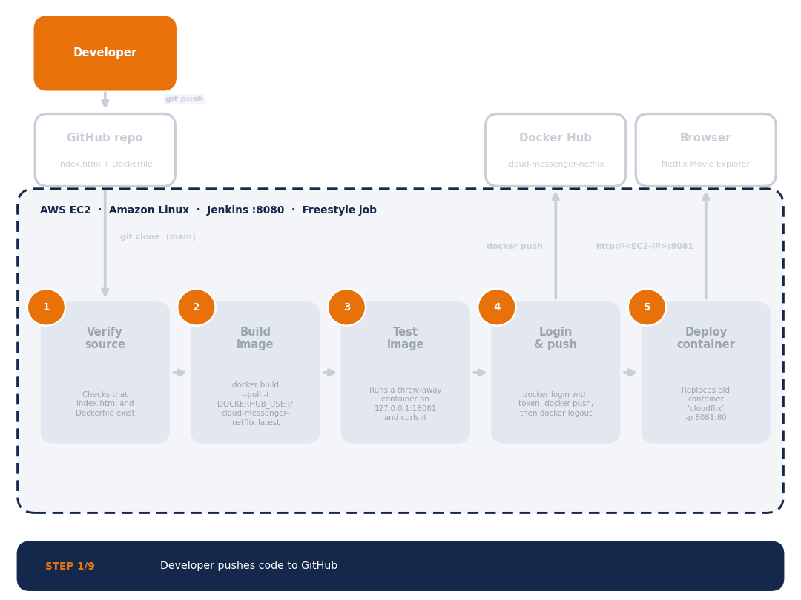

# Jenkins CI/CD Pipeline: Netflix Movie Explorer on AWS EC2 with Docker


**Created by [Rutuja Naik](https://www.linkedin.com/in/rutuja-naik07/)**
&nbsp;|&nbsp; [GitHub Repository](https://github.com/Rutuja-Naik07/Project-Netflix-Jenkins-CI-CD.git)
&nbsp;|&nbsp; [LinkedIn](https://www.linkedin.com/in/rutuja-naik07/)

---

## Table of Contents

1. [Project Overview](#1-project-overview)
2. [Architecture and Workflow](#2-architecture-and-workflow)
3. [Repository Structure](#3-repository-structure)
4. [Prerequisites](#4-prerequisites)
5. [Step 1: Launch the EC2 Instance](#5-step-1-launch-the-ec2-instance)
6. [Step 2: Install Java and Jenkins](#6-step-2-install-java-and-jenkins)
7. [Step 3: Install Git and Docker](#7-step-3-install-git-and-docker)
8. [Step 4: Create the Git Repository](#8-step-4-create-the-git-repository)
9. [Step 5: Prepare Docker Hub](#9-step-5-prepare-docker-hub)
10. [Step 6: Configure Jenkins](#10-step-6-configure-jenkins)
11. [Step 7: Run the Pipeline and Verify](#11-step-7-run-the-pipeline-and-verify)
12. [Command Reference](#12-command-reference)
13. [Troubleshooting](#13-troubleshooting)
14. [Security Recommendations](#14-security-recommendations)
15. [Possible Enhancements](#15-possible-enhancements)
16. [Author](#16-author)

---

## 1. Project Overview

This project builds a complete CI/CD pipeline using **Jenkins** on an **AWS EC2** instance. A static, Netflix-inspired movie website (HTML, CSS and JavaScript) is stored in a **GitHub** repository. Each time Jenkins runs the job, it pulls the latest code, builds a **Docker** image (Nginx serving the site), pushes the image to **Docker Hub**, and runs it as a container reachable from a browser.

**What you will have at the end**

- A working Jenkins server on EC2 (port `8080`)
- A GitHub repository containing `index.html` and a `Dockerfile`
- A Docker image published to Docker Hub
- The Netflix Movie Explorer site running in a container (port `8081`)

| Item | Details |
|---|---|
| Platform | AWS EC2 (Amazon Linux), 30 GB storage |
| CI server | Jenkins on port `8080` |
| Source control | Git and GitHub (`main` branch) |
| Container registry | Docker Hub |
| Deployed app | Nginx container on port `8081` |

## 2. Architecture and Workflow



| Stage | Tool | Purpose |
|---|---|---|
| 1. Source | Git + GitHub | Stores `index.html` and `Dockerfile` |
| 2. Build | Jenkins | Pulls the code and orchestrates the job |
| 3. Package | Docker | Builds an Nginx image containing the site |
| 4. Publish | Docker Hub | Stores the built image |
| 5. Run | AWS EC2 | Runs the container, exposed on port 8081 |

**Flow:** Developer → GitHub → Jenkins (:8080) → verify, build, test, push (Docker Hub) → deploy container `cloudflix` on EC2 (:8081) → Browser.

## 3. Repository Structure

```
Project-Netflix-Jenkins-CI-CD/
├── index.html           # Netflix-style movie explorer website
├── Dockerfile           # Nginx image that serves the website
├── jenkins-build.sh     # Script pasted into the Jenkins "Execute shell" step
├── docs/
│   ├── architecture.gif # Animated pipeline architecture diagram
│   ├── architecture.png # Static version of the diagram
│   ├── Jenkins_CICD_Project_Documentation.pdf
│   └── Jenkins_CICD_Project_Documentation.docx
└── README.md
```

## 4. Prerequisites

- An AWS account with permission to launch EC2 instances
- A GitHub account and a Personal Access Token (PAT)
- A Docker Hub account
- Basic comfort with the Linux terminal and the `vi` editor

## 5. Step 1: Launch the EC2 Instance

| Setting | Value |
|---|---|
| AMI | Amazon Linux |
| Instance type | A large instance, e.g. `m7i.large` |
| Key pair | Proceed without key pair (connect with EC2 Instance Connect) |
| Storage | 30 GB |
| Network settings | Allow SSH, HTTP and HTTPS |

**Open the extra ports**

1. Open the instance's **Security Group** and choose **Edit inbound rules**.
2. Add **Custom TCP** rules for ports **8080** (Jenkins) and **8081** (deployed website).
3. Save the rules, then **Connect** to the EC2 instance.

## 6. Step 2: Install Java and Jenkins

Run these commands in the EC2 terminal.

```bash
sudo su
yum update -y

# Java (required by Jenkins)
sudo yum install -y java-21-amazon-corretto
java -version

# Add the Jenkins repository and signing key
sudo wget -O /etc/yum.repos.d/jenkins.repo \
  https://pkg.jenkins.io/rpm-stable/jenkins.repo
sudo rpm --import https://pkg.jenkins.io/rpm-stable/jenkins.io-2026.key

# Install and start Jenkins
sudo yum install -y jenkins
sudo systemctl enable jenkins
sudo systemctl start jenkins
sudo systemctl status jenkins

# First-time admin password
sudo cat /var/lib/jenkins/secrets/initialAdminPassword
```

**Complete the Jenkins setup in the browser**

1. Open `http://<EC2-public-IP>:8080`.
2. Paste the initial admin password and click **Continue**.
3. Choose **Install suggested plugins**.
4. Create the admin account.
5. Confirm the Jenkins URL and click **Start using Jenkins**.

> **Checkpoint:** You should now see a working Jenkins dashboard.

## 7. Step 3: Install Git and Docker

```bash
# Git
sudo yum install -y git
git --version

# Docker
sudo yum install -y docker
sudo systemctl enable --now docker
sudo systemctl status docker
sudo docker --version
sudo docker ps

# Let Jenkins and ec2-user run Docker without sudo
sudo usermod -aG docker jenkins
sudo usermod -aG docker ec2-user
sudo systemctl restart jenkins

docker ps
```

> **Why this matters:** The `usermod` commands are essential. Without them, Jenkins fails with a *permission denied* error when it talks to the Docker daemon.

## 8. Step 4: Create the Git Repository

### 8.1 Project files

```bash
mkdir <your-project-folder> && cd <your-project-folder>
vi index.html      # paste the website code
vi Dockerfile      # paste the Dockerfile below
```

**Dockerfile**

```dockerfile
# Use lightweight Nginx
FROM nginx:alpine

# Remove the default Nginx page
RUN rm -rf /usr/share/nginx/html/*

# Copy the website into the Nginx directory
COPY index.html /usr/share/nginx/html/index.html

# Expose the web server port
EXPOSE 80

# Start Nginx in the foreground
CMD ["nginx", "-g", "daemon off;"]
```

| Instruction | What it does |
|---|---|
| `FROM nginx:alpine` | Starts from a small Nginx image |
| `RUN rm -rf ...` | Deletes Nginx's default welcome page |
| `COPY index.html ...` | Places the website where Nginx serves files |
| `EXPOSE 80` | Documents that the container listens on port 80 |
| `CMD [...]` | Runs Nginx in the foreground so the container stays alive |

### 8.2 The website (`index.html`)

A single-file, responsive, Netflix-style movie explorer built with HTML, CSS and JavaScript.

- Fixed navigation bar with a live **search** box that filters movie cards
- Hero banner featuring Dune: Part Two with Play and More Info buttons
- Three rows of movies (Trending, Sci-Fi & Adventure, Action & Entertainment) generated from a JavaScript `movies` array
- Details popup with banner, genre, cast and description; closes with the X button, the Esc key, or a click outside
- TMDB poster images with a text fallback card if an image fails to load
- Responsive grid: 6 columns on desktop, 4 on tablets, 2 on phones

### 8.3 Push to GitHub

Create an empty repository on GitHub first, then run:

```bash
git init
git add .                 # or: git add index.html Dockerfile
git status
git commit -m "Landing Page"
git status
git branch -M main
git remote add origin https://github.com/Rutuja-Naik07/Project-Netflix-Jenkins-CI-CD.git
git push -u origin main
```

When prompted, enter your **GitHub username**, and use your **GitHub Personal Access Token** as the password (not your account password).

## 9. Step 5: Prepare Docker Hub

**Create the repository**

1. Log in to Docker Hub and open **Repositories**.
2. Click **Create repository** and give it a name, for example `cloud-messenger-netflix`.

**Generate an access token**

1. Open **Account settings**, then **Personal access token** in the left menu.
2. Click **Generate new token**.
3. Enter an access token name.
4. Set access permissions to **Read & Write** (repository).
5. Click **Generate** and copy the token immediately. It is shown only once.

## 10. Step 6: Configure Jenkins

### 10.1 Add Docker Hub credentials

1. Click the **gear icon (Settings)** in Jenkins and sign in if asked.
2. Go to **Credentials**, then **Global**, then **+ Add Credentials**.
3. Choose **Username with password** and fill in the fields below, then click **Create**.

| Field | Value |
|---|---|
| Username | Your Docker Hub account name |
| Password | The newly created Docker Hub token |
| ID | `dockerhub-creds` |
| Description | `dockerhub-desc` |

### 10.2 Create the freestyle job

1. From the dashboard click **+ New Item**.
2. Enter an **Item name**, choose **Freestyle project**, and click OK.
3. Add any description.

**Source Code Management**

- Select **Git** and paste the **GitHub repository URL**.
- **Credentials:** choose from the drop-down. For a private repo, add a separate *Username with password* credential holding your GitHub username and PAT.
- **Branch Specifier:** change `*/master` to `*/main`.

**Build Environment**

1. Tick **Use secret text(s) or file(s)**.
2. Under **Bindings**, click **Add** and choose **Username and password (separated)**.
3. Set the values below.

| Binding field | Value |
|---|---|
| Username Variable | `DOCKERHUB_USER` |
| Password Variable | `DOCKERHUB_TOKEN` |
| Credentials | `dockerhub-creds` |

**Build Steps**

1. Click **Add build step**, then **Execute shell**.
2. Paste the script below (also available as [`jenkins-build.sh`](jenkins-build.sh)) and click **Save**.

```bash
#!/bin/bash
set -eu

echo "===================================="
echo "STEP 1: Verify source code"
echo "===================================="

test -s index.html
test -s Dockerfile

echo "Website source files found."

echo "===================================="
echo "STEP 2: Build Docker image"
echo "===================================="

IMAGE="$DOCKERHUB_USER/cloud-messenger-netflix:latest"

docker build --pull -t "$IMAGE" .

echo "Docker image built successfully."

echo "===================================="
echo "STEP 3: Test the Docker image"
echo "===================================="

docker run -d --rm \
    --name cloudflix-test \
    -p 127.0.0.1:18081:80 \
    "$IMAGE"

trap 'docker stop cloudflix-test >/dev/null 2>&1 || true' EXIT

sleep 3

curl -fsS http://127.0.0.1:18081/ -o /tmp/cloudflix-test.html

if grep -qi "<html" /tmp/cloudflix-test.html; then
    echo "Website test passed."
else
    echo "ERROR: The website did not return valid HTML."
    cat /tmp/cloudflix-test.html
    exit 1
fi

docker stop cloudflix-test >/dev/null 2>&1 || true
trap - EXIT

echo "Test container cleaned up successfully."

echo "===================================="
echo "STEP 4: Login to Docker Hub"
echo "===================================="

printf '%s' "$DOCKERHUB_TOKEN" | \
    docker login \
        --username "$DOCKERHUB_USER" \
        --password-stdin

echo "Docker Hub login successful."

echo "===================================="
echo "STEP 5: Push image to Docker Hub"
echo "===================================="

docker push "$IMAGE"

docker logout

echo "Image pushed successfully."

echo "===================================="
echo "STEP 6: Deploy container"
echo "===================================="

docker rm -f cloudflix || true

docker run -d \
    --name cloudflix \
    --restart unless-stopped \
    -p 8081:80 \
    "$IMAGE"

echo "===================================="
echo "CI/CD PIPELINE COMPLETED"
echo "===================================="

docker ps --filter "name=cloudflix" --format "table {{.Names}}\t{{.Status}}\t{{.Ports}}"
```

**What the script does**

| Step | Action |
|---|---|
| 1. Verify | Stops the build early if `index.html` or `Dockerfile` is missing or empty. |
| 2. Build | Builds the image `$DOCKERHUB_USER/cloud-messenger-netflix:latest` with `--pull` to get the newest base image. |
| 3. Test | Starts a temporary container on `127.0.0.1:18081`, fetches the page with `curl`, and checks that it returns HTML. The container is removed automatically, even on failure (`trap`). |
| 4. Login | Logs in to Docker Hub using the token through `--password-stdin`, so it never appears in the process list. |
| 5. Push | Pushes the image to Docker Hub, then logs out. |
| 6. Deploy | Removes any old `cloudflix` container and starts the new one on port `8081` with `--restart unless-stopped`. |

> **Tip:** `set -eu` makes the script exit on the first error or unset variable, so a failed test never reaches the push or deploy steps.

## 11. Step 7: Run the Pipeline and Verify

1. Click **Build Now**.
2. Open the build under **Build History** and check **Console Output** for `Finished: SUCCESS`.
3. Confirm the image appears in your Docker Hub repository.
4. Open `http://<EC2-public-IP>:8081`. The Netflix Movie Explorer should load.

On the server, `docker ps` should list the `cloudflix` container as *Up*.

## 12. Command Reference

| Task | Command |
|---|---|
| Check Jenkins | `sudo systemctl status jenkins` |
| Restart Jenkins | `sudo systemctl restart jenkins` |
| Check Docker | `sudo systemctl status docker` |
| List containers | `docker ps` |
| View container logs | `docker logs cloudflix` |
| Stop and remove container | `docker rm -f cloudflix` |
| Initial Jenkins password | `sudo cat /var/lib/jenkins/secrets/initialAdminPassword` |

## 13. Troubleshooting

| Problem | Likely cause and fix |
|---|---|
| Cannot open `:8080` or `:8081` | Security group rule missing, or the service is not running. |
| *permission denied* on Docker in Jenkins | Run `sudo usermod -aG docker jenkins`, then restart Jenkins. |
| Git clone fails in Jenkins | Wrong repo URL, missing credentials for a private repo, or branch still `*/master`. |
| `docker login` fails | Wrong or expired token, or token without write permission. |
| Port 8081 already allocated | An old container is running. Run `docker rm -f cloudflix`. |
| Posters not showing | TMDB image links may have changed. The text fallback card still appears. |
| Jenkins repo or key errors | Check the repo file and key URL. Jenkins periodically rotates its signing key. |

## 14. Security Recommendations

This setup is designed for learning and demos. Before using anything similar beyond that, improve the following:

- **Change the default admin credentials.** Weak passwords such as `admin/admin` must never be used on a public server.
- **Restrict ports 8080 and 8081** to your own IP address instead of `0.0.0.0/0` where possible.
- **Use a key pair** (or AWS Systems Manager) for controlled SSH access.
- **Never commit tokens** to Git. Keep the GitHub PAT and Docker Hub token only in Jenkins credentials.
- **Rotate tokens regularly** and grant minimum permissions.
- **Put HTTPS in front** of Jenkins and the website, for example with a reverse proxy and certificate.

## 15. Possible Enhancements

- Trigger builds automatically with a **GitHub webhook** or SCM polling
- Convert the freestyle job to a **Jenkinsfile** (pipeline as code)
- Tag images with the build number (`:$BUILD_NUMBER`) as well as `latest`
- Add a test or lint stage before the Docker build
- Use an Elastic IP so the public address does not change after a restart

## 16. Author

| Detail | Link |
|---|---|
| Created by | **Rutuja Naik** |
| GitHub repository | https://github.com/Rutuja-Naik07/Project-Netflix-Jenkins-CI-CD.git |
| LinkedIn | https://www.linkedin.com/in/rutuja-naik07/ |

---

*This project is a learning demo. Movie data and images belong to their respective owners (images are loaded from TMDB).*
